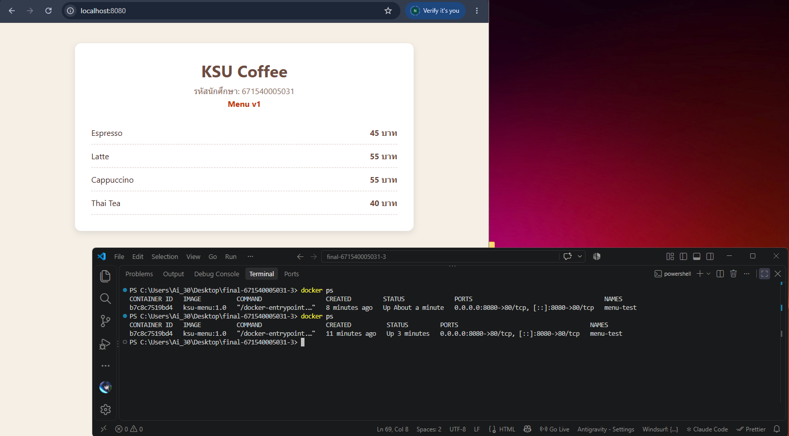
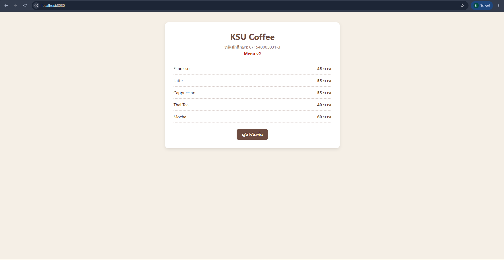
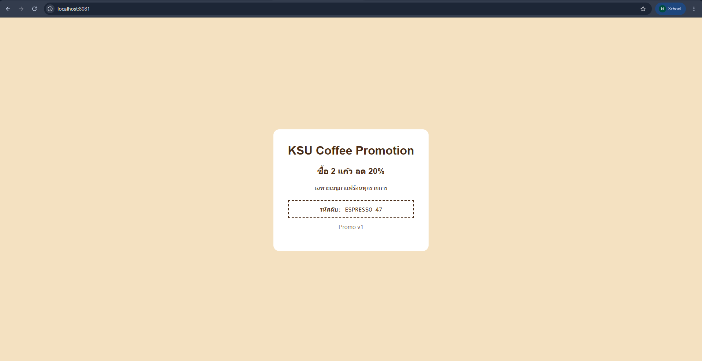

# ANSWER — นายนภัสกรพรรณ พรมช่วย 671540005031-3

## Part A — ข้อมูลจาก image kamthornsa/ksu-promo:1.0

| คำถาม | คำตอบ | คำสั่งที่ใช้ |
| --- | --- | --- |
| Port | `3000/tcp` (ใน history มีบรรทัด `EXPOSE [3000/tcp]` ที่ image นี้เพิ่มเอง ส่วน `80/tcp` ติดมาจาก base image และ nginx config ใน image ตั้ง `listen 3000;`) | `docker image inspect kamthornsa/ksu-promo:1.0 --format "{{json .Config.ExposedPorts}}"` และ `docker history --no-trunc kamthornsa/ksu-promo:1.0` |
| CMD | `["nginx", "-g", "daemon off;"]` (รันผ่าน ENTRYPOINT `/docker-entrypoint.sh`) | `docker image inspect kamthornsa/ksu-promo:1.0 --format "{{json .Config.Cmd}} {{json .Config.Entrypoint}}"` |
| Base image | `nginx:alpine` (nginx 1.31.6 บน Alpine 3.24.2: layer ล่างสุดคือ `alpine-minirootfs-3.24.2`, ENV `NGINX_VERSION=1.31.6`, label `NGINX Docker Maintainers` และ layer 8 ชั้นแรกตรงกับ `nginx:alpine`) | `docker history --no-trunc kamthornsa/ksu-promo:1.0` และ `docker image inspect kamthornsa/ksu-promo:1.0 --format "{{json .RootFS.Layers}}"` |

## Part B — รหัสลับบนหน้าโปรโมชั่น

`ESPRESSO-47` (จากหน้า http://localhost:8081 ของ image `kamthornsa/ksu-promo:1.0` ซึ่งแสดง Promo v1)

## Part C — คำถาม

1.
2.
3.
4.
5.

## ภาพหน้าจอ

